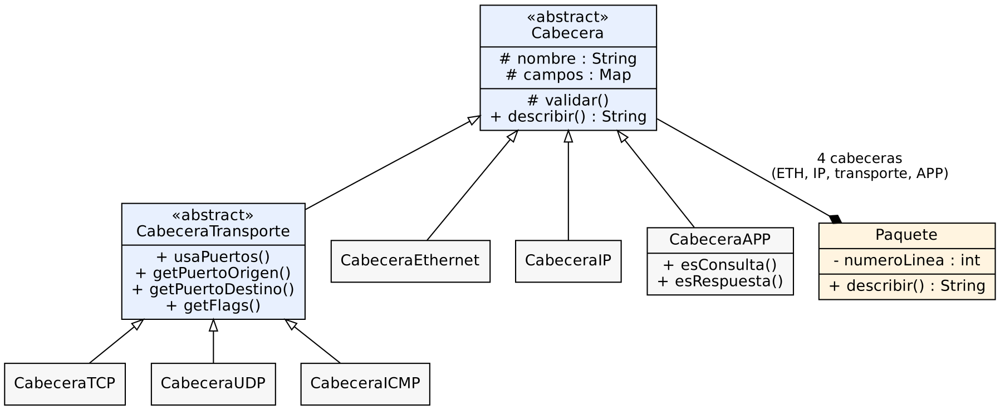
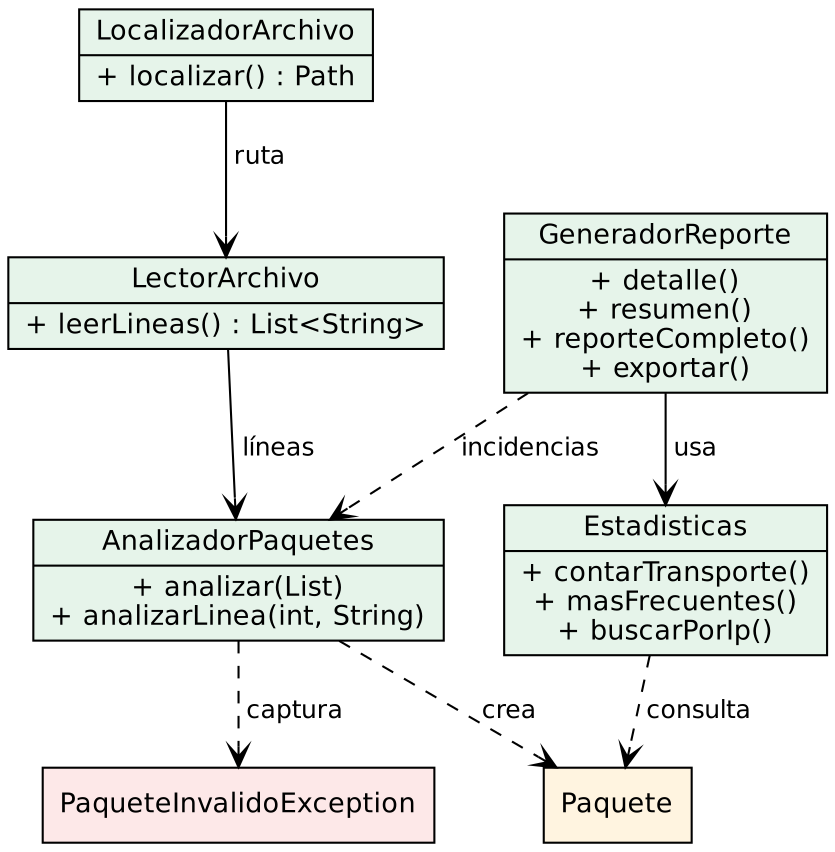

# APE02 Analizador de tráfico de red basado en el modelo TCP/IP
Aplicación de consola en Java (8 o superior) que lee paquetes de red simulados desde `paquetes.txt`, separa sus cabeceras por capa (ETH, IP, TCP, UDP o ICMP, y APP), las muestra con claridad y genera un resumen estadístico.

Proyecto de la guía práctica APE2 de Introducción a Redes, Universidad Técnica de Ambato, Carrera de Software, Nivel III, Paralelo B. Docente: Ing. Daniel Maldonado-Ruiz, Ph.D.

## Equipo

- Altamirano Segovia Jullisa Brigitte
- Chico Yunda Juan Carlos
- Ramírez Tigse Ruth Betzabeth
- Tuza Quinatoa Edith Noemi

Repositorio: Pendiente de crear

## Formato de cada línea

```
ETH{src=...,dst=...,type=IPv4}|IP{src=...,dst=...,ttl=64,proto=TCP}|TCP{sport=...,dport=...,seq=...,ack=...,flags=...}|APP{proto=HTTP,data=...}
```

El tercer bloque puede ser `TCP{...}`, `UDP{sport,dport,length}` o `ICMP{type,code,id,seq}`.

## Estructura del proyecto

```
analizador_red_final/
├── paquetes.txt
├── prueba_mal.txt
├── README.md
├── diagramas/
│   ├── diagrama-jerarquia.png
│   ├── diagrama-colaboracion.png
│   ├── diagramas.md
│   └── *.dot
└── src/
    ├── app/        Main
    ├── io/         LectorArchivo, LocalizadorArchivo
    ├── analisis/   AnalizadorPaquetes
    ├── modelo/     Cabecera, CabeceraTransporte, CabeceraEthernet, CabeceraIP,
    │               CabeceraTCP, CabeceraUDP, CabeceraICMP, CabeceraAPP,
    │               Paquete, PaqueteInvalidoException
    └── reporte/    Estadisticas, GeneradorReporte
```

## Clases y responsabilidades

| Clase | Paquete | Responsabilidad |
|---|---|---|
| Main | app | Arranque, pantalla de inicio y menú interactivo |
| LocalizadorArchivo | io | Encuentra `paquetes.txt` aunque cambie el directorio de trabajo |
| LectorArchivo | io | Lee todas las líneas del archivo en UTF-8 |
| AnalizadorPaquetes | analisis | Divide, valida y crea los `Paquete`; registra errores y líneas vacías |
| Cabecera | modelo | Clase abstracta: nombre, mapa de campos, `validar()` y `describir()` |
| CabeceraTransporte | modelo | Abstracta: puertos y flags comunes a TCP, UDP e ICMP |
| CabeceraEthernet, CabeceraIP | modelo | Capas de acceso a red e Internet |
| CabeceraTCP, CabeceraUDP, CabeceraICMP | modelo | Capa de transporte; cada una valida y describe sus campos |
| CabeceraAPP | modelo | Protocolo y datos; detecta consultas y respuestas |
| Paquete | modelo | Compone las cuatro cabeceras de una línea |
| PaqueteInvalidoException | modelo | Excepción para paquetes mal formados |
| Estadisticas | reporte | Conteos, frecuencias, búsquedas y filtros |
| GeneradorReporte | reporte | Formato del detalle, resumen, incidencias y exportación |

## Diagramas

La clase `Main` solo arranca el programa y no forma parte de los diagramas.





Las versiones en Mermaid y los archivos fuente están en [diagramas/](diagramas/diagramas.md).

## Compilar

Desde esta carpeta:

```
Windows:      dir /s /b src\*.java > fuentes.txt
              javac -encoding UTF-8 -d out @fuentes.txt

Linux/macOS:  find src -name "*.java" > fuentes.txt
              javac -encoding UTF-8 -d out @fuentes.txt
```

## Ejecutar

```
java -cp out app.Main paquetes.txt             pantalla de inicio: análisis completo o menú
java -cp out app.Main paquetes.txt --sin-menu  imprime el análisis completo y termina
java -cp out app.Main paquetes.txt --menu      entra directo al menú
```

- En la pantalla de inicio, pulsar Enter equivale a la opción 1 (análisis completo).
- Si no hay entrada de teclado disponible, se muestra el análisis completo.
- El archivo de paquetes se busca en la carpeta actual, en sus subcarpetas y en las carpetas superiores. La ruta encontrada se muestra al iniciar. También se puede indicar una ruta completa como argumento.
- Lo más seguro es dejar `paquetes.txt` junto a la carpeta `src`.
- En consolas de Windows con tildes mal mostradas: `chcp 65001`.

## Menú interactivo

1. Ver todos los paquetes
2. Ver un paquete por número de línea
3. Ver resumen estadístico
4. Buscar por dirección IP
5. Filtrar por protocolo de transporte
6. Filtrar por protocolo de aplicación
7. Ver incidencias (líneas mal formadas y vacías)
8. Exportar análisis a archivo (`reporte_analisis.txt`)
0. Volver

## Validaciones

Cada línea debe tener cuatro bloques. Se comprueban: formato de MAC, IPv4 de cuatro octetos (0-255), TTL (0-255), puertos (0-65535), longitud UDP (8-65535), tipo y código ICMP (0-255), campos obligatorios y que el protocolo declarado en IP coincida con el bloque de transporte. Una línea defectuosa se reporta con su número y no detiene el programa. `prueba_mal.txt` contiene ejemplos de cada caso.

## Resultados con `paquetes.txt`

| Concepto | Valor |
|---|---|
| Líneas leídas | 174 |
| Paquetes válidos | 160 |
| Líneas mal formadas | 0 |
| Líneas vacías (omitidas) | 14 |
| TCP | 104 (65 %) |
| UDP | 42 (26,25 %) |
| ICMP | 14 (8,75 %) |
| IP origen más frecuente | 192.168.1.1 y 1.1.1.1 (7 cada una) |
| IP destino más frecuente | 93.184.216.34 (14) |
| Puerto destino más frecuente | 25 (18) |
