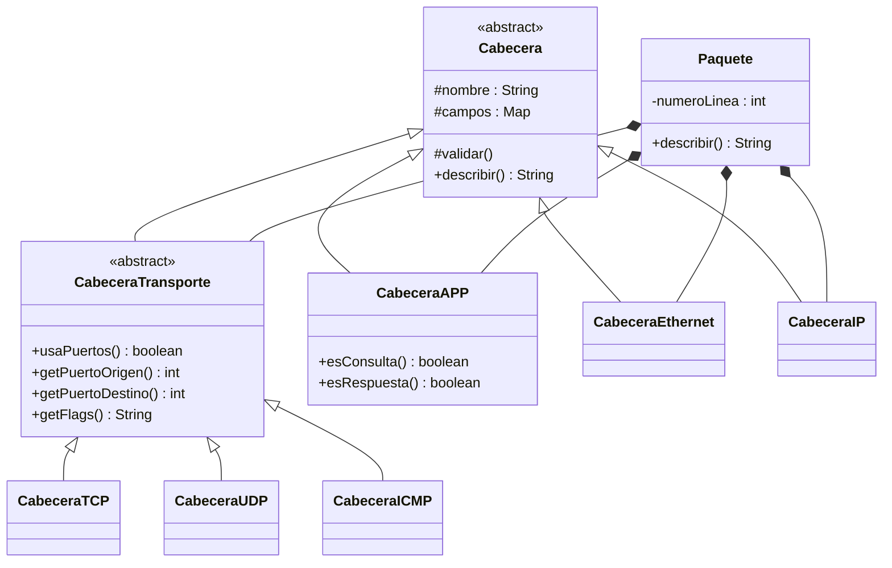
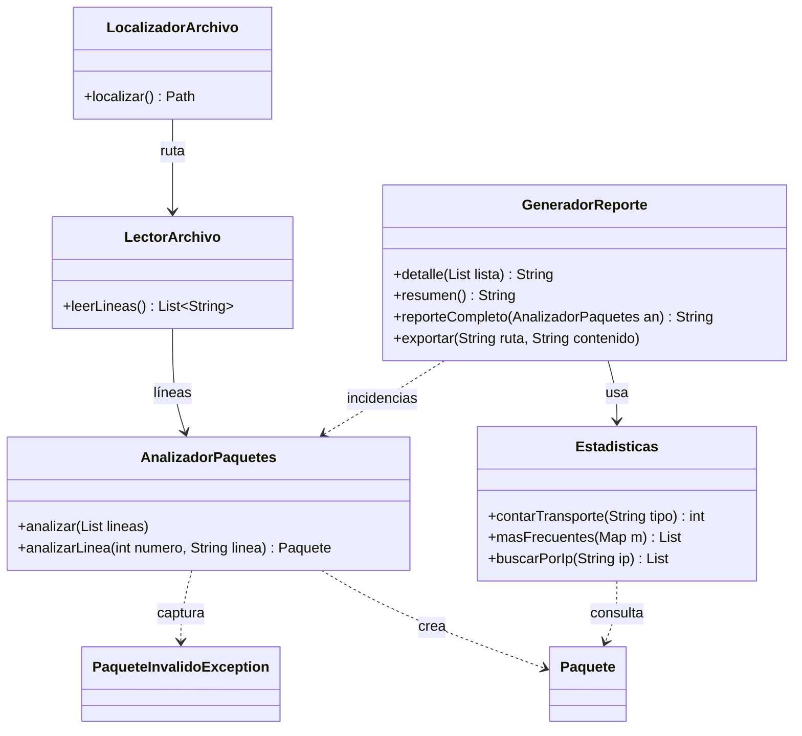

# Diagramas de clases

La clase `Main` solo arranca el programa y no forma parte de los diagramas.

## Jerarquía de cabeceras y composición del paquete




## Colaboración entre clases




Para regenerar las imágenes a partir de los archivos `.dot` (requiere Graphviz):

```
dot -Tpng -Gdpi=150 diagrama-jerarquia.dot -o diagrama-jerarquia.png
dot -Tpng -Gdpi=150 diagrama-colaboracion.dot -o diagrama-colaboracion.png
```
